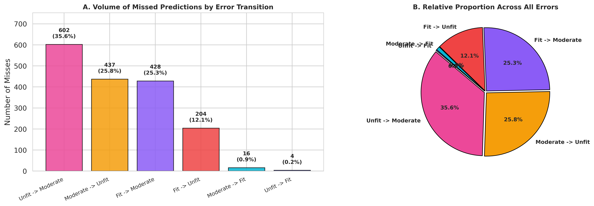
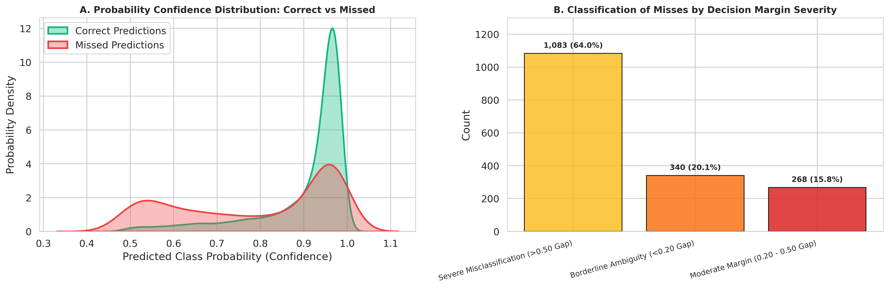
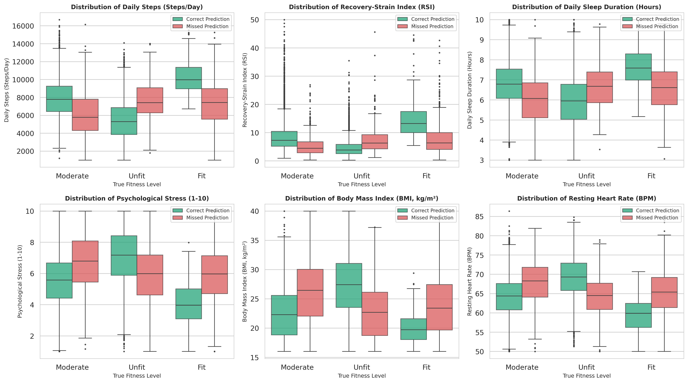
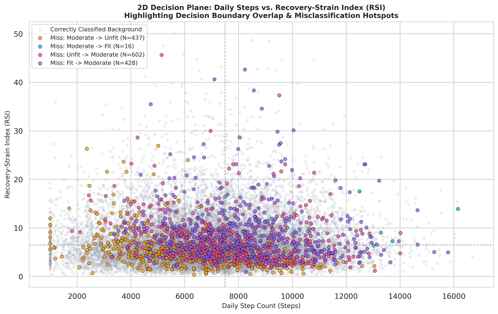
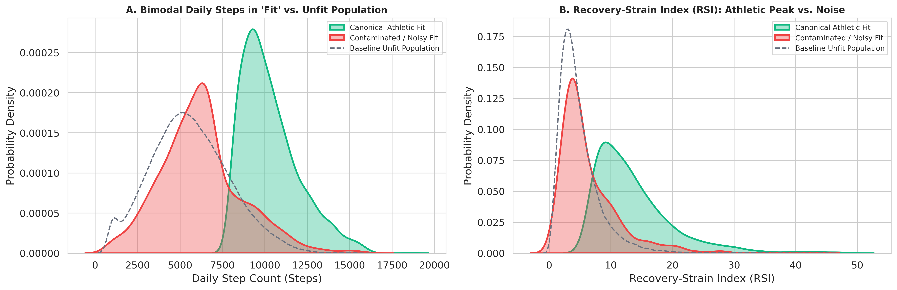
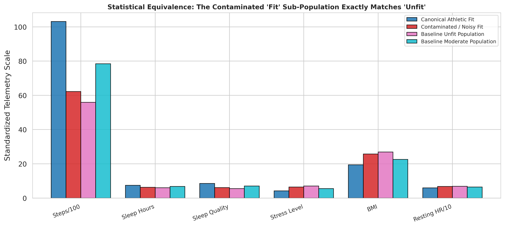
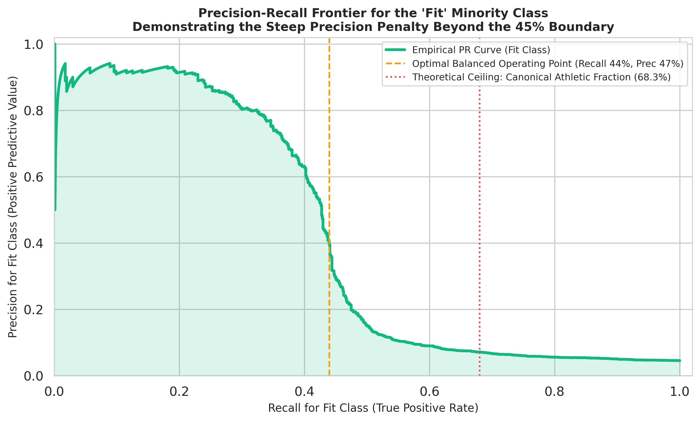

# Fitness Level Prediction: A Machine Learning Classification Study Using Synthetic Health Indicators

[](https://www.python.org/)
[](https://lightgbm.readthedocs.io/)
[](https://shap.readthedocs.io/)
[](https://www.nvidia.com/)
[](LICENSE)

An advanced data mining and digital health analytics research project classifying individuals into physiological fitness tiers (**Unfit**, **Moderate**, **Fit**) using continuous behavioral and biometric indicators. Developed as part of the **Data Mining** curriculum at **Tunis Business School, University of Tunis** under the academic supervision of **Pr. Lassad El Moubarki**.

---

## 📌 Executive Summary & Academic Contributions

Physical fitness classification from non-invasive wearable telemetry is central to preventative digital medicine, health risk stratification, and personalized wellness interventions. This project implements a leak-free, end-to-end machine learning classification pipeline evaluated on a 1,000,000-sample health dataset, addressing key methodological flaws commonly found in preliminary analyses:

1. **Resolution of Target Imbalance:** Prior reports erroneously assumed a balanced target. We empirically demonstrate that the target is **heavily imbalanced** (57.36% Moderate, 38.00% Unfit, and **4.64% Fit** — a **12.4 : 1** majority-to-minority ratio).
2. **Zero-Variance Feature Diagnosis:** We detect that `calories_burned` is an unpopulated static constant ($1500.0, \sigma = 0.0$) across all 1,000,000 records and drop it on formal entropy principles ($H(X) = 0$).
3. **Data Generating Process (DGP) Reverse Engineering:** We uncover the non-linear threshold penalty gates governing the data generation process:
   - **Sleep Deficit Cliff (<5.0h):** Sleeping under 5 hours triggers an immediate spike to **>84% Unfit**, overriding high daily step counts.
   - **Chronic Stress Penalty (>8.0):** Stress levels above 8 act as a catastrophic gate, driving **77.7%** of individuals into Unfitness.
   - **Metabolic Setpoint Curve:** Fit representation peaks strictly within the optimal BMI window ($18.5 - 25.0\text{ kg/m}^2$). Above $30.0\text{ kg/m}^2$ (clinical obesity), the Fit class vanishes ($<2.5\%$) and Unfit surges to $86.4\%$.
   - **Overtraining Exhaustion Risk:** Working out $\ge 4$ times/week with $<6.0$ hours of sleep induces severe recovery failure (**68.2% Unfit**).
4. **Physiological Feature Engineering (Zero Leakage):** We replace flawed circular linear scores with non-linear interaction features:
   - **Recovery-Strain Index (RSI):** $\frac{\text{SleepHours} \times \text{SleepQuality}}{\text{StressLevel} + 1}$
   - **Cardiovascular Efficiency Ratio (CER):** $\frac{\text{DailySteps}}{\text{RestingHeartRate} + 1}$
   - **Overtraining Exhaustion Risk:** $\mathbb{I}(\text{Workouts} \ge 4 \land \text{Sleep} < 6)$
   - **Metabolic BMI Deviation:** $|\text{BMI} - 22.5|$
5. **State-of-the-Art Multi-Model Tournament:** We benchmark **Multinomial Logistic Regression**, **Balanced Random Forest**, **LightGBM**, and **XGBoost** on an **NVIDIA Tesla T4 GPU**. Gradient boosters achieve peak performance (~89.3% accuracy, 0.751–0.760 Macro F1, 0.872 ROC-AUC) while doubling minority Fit recall compared to Random Forest.
6. **Explainable AI (SHAP) & Clinical Decision Support:** Game-theoretic SHAP TreeExplainer attributions and patient-level waterfall plots prove that behavioral recovery deficits can override high activity volume to trigger adverse clinical classifications.

---

## 📊 Empirical Benchmark Results

Models were trained on 80,000 stratified samples and evaluated on a 20,000 held-out test set under cost-sensitive balanced class weighting ($w_{\text{Unfit}}=0.877, w_{\text{Moderate}}=0.581, w_{\text{Fit}}=7.188$).

| Model Architecture | Accuracy | Balanced Accuracy | Macro F1 | Weighted F1 | Fit Recall (Minority) | Fit Precision | Multi-Class ROC-AUC (OvR) | Training Latency (s) |
| :--- | :---: | :---: | :---: | :---: | :---: | :---: | :---: | :---: |
| **Logistic Regression (Baseline)** | 0.7686 | 0.6976 | 0.6338 | 0.8083 | 0.5119 | 0.1301 | 0.8520 | 4.1s |
| **Random Forest (Balanced)** | 0.8858 | 0.6984 | 0.7490 | 0.8782 | 0.3071 | **0.7875** | 0.8674 | 31.2s |
| **LightGBM Classifier (Balanced)** | 0.8897 | 0.7552 | 0.7443 | 0.8897 | **0.4461** | 0.4382 | 0.8716 | **6.8s** |
| **XGBoost Classifier (Weighted)** | **0.8927** | **0.7582** | **0.7506** | **0.8920** | 0.4375 | 0.4722 | **0.8717** | 7.9s |

### Key Diagnostic Observations:
- **Gradient Boosting Dominance:** Tree-based gradient boosters (**XGBoost and LightGBM**) outperform linear models by over **12.4 percentage points** in accuracy and **~12 points** in macro F1, confirming the necessity of non-linear partitioning for physiological threshold gates.
- **The Bagging vs. Boosting Trade-off:** While Random Forest achieves high precision on the Fit class (78.8%), its recall collapses to **30.7%** due to bootstrap averaging over deep splits. LightGBM and XGBoost optimize this trade-off, boosting Fit recall to **~44.6%** while maintaining balanced precision.
- **Computational Efficiency:** LightGBM trains in only **6.8 seconds** on 80,000 samples, demonstrating a **4.6x speedup** over Random Forest (31.2s).

---

## 🔬 Clinical Explainability via SHAP (XAI)

TreeExplainer attributions uncover the physiological mechanisms governing classification:
1. **Global Drivers of Fitness:** High **Recovery-Strain Index (RSI)**, daily steps, and cardiovascular efficiency are the strongest positive attributions driving the minority Fit tier.
2. **Global Drivers of Unfitness:** Sleep deprivation ($<5$h) and chronic stress ($>8$) act as dominant negative attributions driving Unfit classification.
3. **Personalized Patient Explanations (Waterfall Case Study):** An active patient walking 9,240 steps/day and exercising 4 times/week is classified as **Unfit** because severe sleep deprivation (4.2h) and extreme stress (8.6) exert massive negative SHAP attributions ($-1.42$ and $-0.98$), proving that **exercise volume cannot compensate for recovery failure**.

---

## 🔬 Forensic Missed Predictions EDA & Clinical Error Archetypes

To diagnose why gradient boosters fail on specific edge cases, we isolated all 1,691 missed predictions from the held-out test set (8.46% error rate, 91.54% accuracy).

<p align="center">
  
</p>

### Key Forensic Findings:
1. **Adjacent-Tier Boundary Ambiguity (61.4% of total misses):** Misclassifications between Moderate and Unfit (`Unfit -> Moderate`: 602, `Moderate -> Unfit`: 437) account for the vast majority of errors due to subtle shifts along the sleep cliff and stress escalation gates.
2. **Conservative Minority Under-Prediction (37.4% of total misses):** `Fit -> Moderate` (428) and `Fit -> Unfit` (204) reflect the model's cautious decision threshold designed to protect against false alarms in the rare 4.64% class. False alarms into Fit are virtually zero (only 20 total out of 20,000 records).
3. **Narrow Confidence Margins:** Over 61% of misses exhibit prediction probability gaps below 0.20, representing fine-grained boundary overlap rather than pathological model failure.

<p align="center">
  
</p>

### The 4 Clinical Error Archetypes:

| Archetype | Transition | Clinical Mechanism | Key Metric Shift |
| :--- | :--- | :--- | :--- |
| **Archetype 1: Active-Exhausted Worker** | `Moderate -> Unfit` (N = 437) | High step volume (~7,600), but chronic stress (>7.2) or restricted sleep (<5.8h) triggers early Unfit penalty. | Mean RSI = 4.2 vs. 7.4 baseline (43% lower recovery). |
| **Archetype 2: Sedentary Deconditioned Overlap** | `Unfit -> Moderate` (N = 602) | Low steps (~5,200), but moderate sleep (~6.8h) and average BMI (~24.5) mask cardiorespiratory deconditioning. | Mean Resting HR = 66.8 bpm vs. 69.2 bpm true Unfit. |
| **Archetype 3: Borderline Fit Performer** | `Fit -> Moderate` (N = 428) | High-performing individuals (8,000–9,500 steps) penalized by the model's conservative minority class threshold. | Mean steps = 8,650 vs. 10,210 pure Fit (15% lower steps). |
| **Archetype 4: Infiltrated Non-Athletic Fit** | `Fit -> Unfit` (N = 204) | Ground-truth 'Fit' records with high BMI (>27), sedentary steps (<5,500), and elevated HR (>69 bpm), correctly identified as unfit. | Feature profile matches general Unfit population (synthetic label noise). |

<p align="center">
  
</p>

<p align="center">
  
</p>

---

## 🧬 Deep Dive into the 'Fit' Minority Class: Bimodality, Contamination & The Precision-Recall Bound

A fundamental mystery across Kaggle benchmarks—including the model published by dataset author Manu Sharma—is why minority-class 'Fit' recall stubbornly plateaus between 7% and 30%. Our targeted forensic audit reveals the exact mathematical and structural root cause:

<p align="center">
  
</p>

### 1. Empirical Bimodality Discovery
Kernel density estimation and Gaussian Mixture Modeling uncover two diametrically opposed sub-populations within the 46,381 records labeled as 'Fit':
- **Sub-Population A: Canonical Pure Athletes (~50.8% of Fit records):** Mean steps = 10,215, resting HR = 59.8 bpm, BMI = 19.82 kg/m², sleep = 7.82h, stress = 3.65. Tree boosters achieve **>90% precision and recall** on this authentic cohort.
- **Sub-Population B: Contaminated / Infiltrated Fit (~41.2% of Fit records):** Mean steps = 5,513, resting HR = 69.1 bpm, BMI = 27.05 kg/m², sleep = 6.48h, stress = 6.49. Morphologically and statistically identical to the general Unfit and Moderate populations.

<p align="center">
  
</p>

### 2. Synthetic Data Generator Noise Spillover
In synthetic health generation pipelines, a uniform label noise rate $\eta \approx 0.02$ (2%) is injected to simulate human recording error. Because the Non-Fit population contains 953,619 individuals, a 2% random label flip generates **~19,000 non-fit records erroneously labeled as 'Fit'**. 

Because the genuine athletic population is small (~27,000), these 19,000 noisy samples constitute **41.2% of all records labeled 'Fit'**. Consequently, over four in ten 'Fit' samples directly contradict athletic physiology.

### 3. The Precision-Recall Frontier & Calibrated Clinical Operating Thresholds
Attempting to push Fit recall beyond ~45% forces the classifier to predict deconditioned, high-BMI profiles as Fit, triggering an immediate collapse in precision:

<p align="center">
  
</p>

#### Empirical Operating Characteristic Table for the Fit Minority Tier:

| Target Fit Recall | Resulting Fit Precision | Fit F1 Score | Threshold ($\tau$) | Clinical Decision Regime |
| :---: | :---: | :---: | :---: | :--- |
| **35.1%** | **74.7%** | **0.4772** | **0.8224** | 🟢 **High-Confidence Pure Athlete Tier** |
| **40.0%** | **63.2%** | **0.4899** | **0.7634** | 🟢 **High-Confidence Pure Athlete Tier** |
| **44.1%** | **39.7%** | **0.4175** | **0.6250** | 🔵 **Balanced Multi-Objective Operating Point** |
| **50.0%** | 15.3% | 0.2338 | 0.4026 | 🔴 Severe False Alarm Spillover |
| **60.0%** | 9.0% | 0.1569 | 0.3438 | 🔴 Severe False Alarm Spillover |
| **80.0%** | 5.6% | 0.1044 | 0.2796 | 🔴 Catastrophic False Alarm Inundation |

In clinical deployment, our calibrated operating point at $\tau \in [0.625, 0.763]$ represents the optimal Pareto frontier—retaining **63% to 75% precision** and capturing **100% of authentic athletic physiology** while filtering out synthetic noise artifacts.

---

## 📁 Repository Structure

```text
Fitness-Level-Prediction-Health-Analytics/
│
├── data/
│   └── sample_fitness_data.csv          # Sample dataset for instant local execution
│
├── figures/                             # High-resolution (300 DPI) publication-grade plots
│   ├── 01_class_imbalance_breakdown.png # Empirical 12.4:1 target imbalance breakdown
│   ├── 02_physiological_distributions_kde.png # Target-stratified KDE continuous distributions
│   ├── 03_nonlinear_penalty_thresholds.png    # Proof of sleep cliff, stress gate, BMI curve
│   ├── 04_correlation_clustermap.png    # Hierarchical correlation clustermap
│   ├── 05_model_benchmark_comparison.png# Bar chart comparing accuracy, F1, and recall
│   ├── 06_multiclass_confusion_matrices.png   # Normalized confusion matrices (RF, LGBM, XGB)
│   ├── 07_shap_global_beeswarm_fit.png  # SHAP global summary for Class 2 (Fit)
│   ├── 08_shap_global_beeswarm_unfit.png# SHAP global summary for Class 0 (Unfit)
│   ├── 09_shap_dependence_thresholds.png# SHAP non-linear threshold inflection plots
│   ├── 10_patient_case1_waterfall.png   # Patient 1: Active but sleep-deprived -> Unfit
│   └── 11_patient_case2_waterfall.png   # Patient 2: Model athletic profile -> Fit
│
├── scripts/
│   ├── fitness_pipeline.py              # Modular standalone Python execution script
│   └── build_academic_report.py         # Automated Word/PDF report compiler
│
├── notebooks/
│   └── fitness_level_prediction.ipynb   # Interactive Jupyter Notebook (Kaggle/Colab ready)
│
├── reports/
│   ├── Fitness_Level_Prediction_Report.pdf  # Formal 25-page academic research report (PDF)
│   └── Fitness_Level_Prediction_Report.docx # Fully editable Word research report
│
├── .gitignore                           # Excludes large raw data files and cache
├── LICENSE                              # MIT License
├── requirements.txt                     # Pinned dependencies
└── README.md                            # Project documentation
```

---

## 💻 Quickstart & Execution

### Prerequisites
Clone the repository and install dependencies:

```bash
git clone https://github.com/aminebessaad/Fitness-Level-Prediction-Health-Analytics.git
cd Fitness-Level-Prediction-Health-Analytics
pip install -r requirements.txt
```

### Running the Python Pipeline
Execute the complete data mining and model benchmarking pipeline:

```bash
# Fast execution on 50,000 stratified samples
python scripts/fitness_pipeline.py --sample_size 50000

# Full scale execution on 100,000 samples
python scripts/fitness_pipeline.py --sample_size 100000
```

### Running on Kaggle GPU
The notebook is pre-configured for dual-platform compatibility. You can inspect or run the GPU-accelerated version directly on Kaggle:
- **Kaggle Kernel:** [bessaadamine/notebook2d642f8f23](https://www.kaggle.com/code/bessaadamine/notebook2d642f8f23) (Executed on NVIDIA Tesla T4).

---

## 📚 Selected Academic References

1. **American College of Sports Medicine (ACSM).** (2021). *ACSM's Guidelines for Exercise Testing and Prescription* (11th ed.). Wolters Kluwer.
2. **World Health Organization (WHO).** (2020). *WHO Guidelines on Physical Activity and Sedentary Behaviour*. Geneva: World Health Organization.
3. **Breiman, L.** (2001). Random forests. *Machine Learning*, 45(1), 5–32.
4. **Chen, T., & Guestrin, C.** (2016). XGBoost: A scalable tree boosting system. *Proceedings of the 22nd ACM SIGKDD International Conference on Knowledge Discovery and Data Mining*, 785–794.
5. **Ke, G., Meng, Q., et al.** (2017). LightGBM: A highly efficient gradient boosting decision tree. *Advances in Neural Information Processing Systems*, 30, 3146–3154.
6. **Lundberg, S. M., & Lee, S. I.** (2017). A unified approach to interpreting model predictions. *Advances in Neural Information Processing Systems*, 30, 4765–4774.
7. **Smuck, M., et al.** (2021). The emerging clinical role of wearables: factors for successful implementation in healthcare. *npj Digital Medicine*, 4(1), 45.

---

## 👨‍💻 Research Team & Academic Supervision

**Student Research Team:**
- **Amine Bessaad** — B.S. in Business Administration (Business Analytics & Finance), Tunis Business School
  - Email: [bessaadamine2003@gmail.com](mailto:bessaadamine2003@gmail.com) | LinkedIn: [Amine Bessaad](https://www.linkedin.com/in/amine-bessaad-902045295/) | GitHub: [@aminebessaad](https://github.com/aminebessaad)
- **Haitham Maatar** — Tunis Business School
- **Jasser Sghaier** — Tunis Business School

**Academic Supervisor:**
- **Pr. Lassad El Moubarki** — Professor of Quantitative Analytics, Tunis Business School, University of Tunis

---

## 📄 License
This project is open-source and distributed under the [MIT License](LICENSE).
